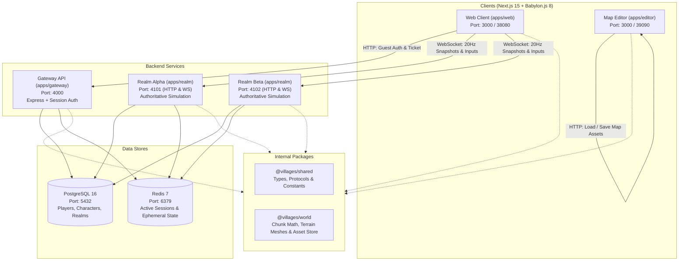

# Villages Online

Villages Online is a multiplayer, browser-based 3D voxel/terrain village game prototype and real-time world builder. The project features authoritative real-time game simulation, chunk-based terrain streaming, a full-featured in-browser 3D map editor, and containerized local and production orchestration.

---

## Architecture Overview



### Components

- **`apps/web`**: Player game client built with Next.js 15 (React 19) and Babylon.js. Handles guest authentication, character selection/creation, chunk rendering, entity interpolation, and movement controls (WASD/arrows + space to jump).
- **`apps/editor`**: Standalone 3D map editor built with Next.js and Babylon.js. Allows chunk expansion/removal, terrain sculpting (raise/lower/flatten), water painting/erasing, and NPC placement (standing, patrol paths, wandering).
- **`apps/gateway`**: Central Express REST API service. Handles guest registration and token authentication, character persistence, Redis session management, realm directory listings, and issuance of opaque realm join tickets.
- **`apps/realm`**: Authoritative game realm server running Express and WebSockets (`ws`). Runs a fixed 20Hz simulation tick loop handling player movement, gravity, collision/grounding, NPC pathfinding, chunk streaming, and snapshot broadcasts. Supports running multiple realm instances (e.g., `alpha` and `beta`).
- **`packages/shared`**: Shared TypeScript types (DTOs, protocol payloads, entity snapshots), game constants (`TICK_RATE`, `CHUNK_SIZE`, `CHUNK_RESOLUTION`, `PLAYER_SPEED`, `GRAVITY`, `JUMP_VELOCITY`), and utility helpers (`sanitizeNickname`).
- **`packages/world`**: Core terrain geometry, chunk index calculations, height mapping (`getHeightAt`), Babylon.js terrain mesh generation (`buildTerrainScene`), map editor mutation logic, and file-based map asset store (`starter-valley.json`).
- **`infra/`**: PostgreSQL initialization SQL (`infra/postgres/init.sql`) and container tooling (`infra/tooling/dev-app.Dockerfile`).
- **`tests/`**: Playwright end-to-end multi-client tests (`tests/e2e/smoke.spec.ts`) verifying character creation, realm entry, movement, and player co-presence.

---

## Ports and Services

| Service         | Port (Host / Compose)             | Protocol          | Description                                                          |
| :-------------- | :-------------------------------- | :---------------- | :------------------------------------------------------------------- |
| **Gateway**     | `4000`                            | HTTP              | Auth, character creation, realm tickets                              |
| **Realm Alpha** | `4101`                            | HTTP / WS (`/ws`) | Authoritative game simulation (Alpha realm)                          |
| **Realm Beta**  | `4102`                            | HTTP / WS (`/ws`) | Authoritative game simulation (Beta realm)                           |
| **Web Client**  | `3000` (local) / `38080` (docker) | HTTP              | Player Next.js game client                                           |
| **Map Editor**  | `3000` (local) / `39090` (docker) | HTTP              | Next.js 3D map editor                                                |
| **PostgreSQL**  | `5432`                            | TCP               | Relational persistence (`villages:villages@localhost:5432/villages`) |
| **Redis**       | `6379`                            | TCP               | Session cache & fast pub/sub                                         |

---

## Prerequisites

- **Node.js**: `v20.x` or later (tested on Node `v24.x`)
- **Corepack / Yarn**: Yarn Berry `4.9.1` (managed via `corepack enable`)
- **Docker & Docker Compose**: (Optional, for full-stack containerized development)

---

## Getting Started

### 1. Install Dependencies

Enable Corepack and install monorepo dependencies:

```bash
corepack enable
yarn install
```

### 2. Running Locally (Docker Compose)

The easiest way to run all services (PostgreSQL, Redis, Gateway, Realm Alpha, Realm Beta, Web Client, and Map Editor) is via Docker Compose:

```bash
# Start all dev services in background
yarn docker:up

# Or run with live container logs
yarn dev

# Tear down services and volumes
yarn docker:down
```

Once running:

- **Game Client**: [http://localhost:38080](http://localhost:38080)
- **Map Editor**: [http://localhost:39090](http://localhost:39090)
- **Gateway Health**: [http://localhost:4000/health](http://localhost:4000/health)
- **Realm Alpha Health**: [http://localhost:4101/health](http://localhost:4101/health)

### 3. Running Services Individually

If running PostgreSQL and Redis separately on localhost (ports `5432` and `6379`):

```bash
# Terminal 1: Run Gateway
yarn dev:gateway

# Terminal 2: Run Realm Alpha
yarn dev:realm:alpha

# Terminal 3: Run Web Client
yarn dev:web

# Terminal 4: Run Map Editor
yarn dev:editor
```

---

## Development Scripts

All core development commands can be executed from the monorepo root:

| Command                 | Description                                                     |
| :---------------------- | :-------------------------------------------------------------- |
| `yarn build`            | Build all packages and Next.js applications                     |
| `yarn test`             | Run all Vitest unit tests across apps and packages              |
| `yarn typecheck`        | Type-check all packages and apps (`tsc --noEmit` & `next lint`) |
| `yarn lint`             | Lint all JavaScript / TypeScript files with ESLint              |
| `yarn lint:fix`         | Automatically fix ESLint warnings and errors                    |
| `yarn format`           | Format the entire codebase with Prettier                        |
| `yarn format:check`     | Verify formatting consistency with Prettier                     |
| `yarn test:e2e`         | Run Playwright end-to-end tests locally                         |
| `yarn docker:test:e2e`  | Run Playwright E2E tests inside Docker test container           |
| `yarn build:images`     | Build production Docker images for all services                 |
| `yarn build:dev:images` | Build development Docker images                                 |

---

## Map Editor

The Map Editor (`apps/editor`) allows direct manipulation of map assets (such as `starter-valley.json` in `packages/world/assets/`):

- **Chunk Management**: Add or remove terrain chunks in 2D grid space.
- **Terrain Sculpting**: Left-click drag to sculpt elevations (configurable brush radius, intensity, and up/down delta). Hold **Space** to pan the camera.
- **Water Painter**: Paint or clear water cells at configurable water levels.
- **NPC Tools**: Place NPCs and configure behaviors:
  - `standing`: Stationary NPC, automatically grounded to terrain height.
  - `patrol`: Path-following NPC that loops through assigned waypoint coordinates.
  - `wandering`: Autonomous NPC that randomly wanders within a configurable radius of home.
- **Save / Export**: Directly updates published map assets via `/api/maps/[mapId]`.

---

## Testing

### Unit & Integration Tests (Vitest)

Unit tests cover auth token hashing, simulation physics, grounding, NPC behaviors, chunk indexing, height calculation, and terrain scene mapping:

```bash
yarn test
```

### End-to-End Tests (Playwright)

Smoke tests verify full multiplayer lifecycle:

1. Guest signup and character creation.
2. Realm loading screen to in-game HUD transition.
3. Player movement and jump verification.
4. Multi-client session co-presence and mutual visibility.

```bash
yarn test:e2e
```
