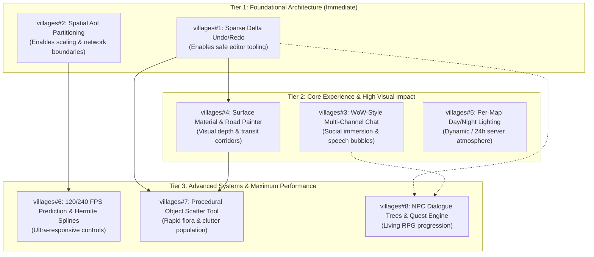

# Ideas & Feature Proposals

This document tracks feature proposals, technical designs, and gameplay concepts for the `villages-online` platform. It is structured to be easily parsed and acted upon by both AI agents and human developers.

---

## Index

| ID                                                                                                                       | Kanzo Task   | Title                                                                                                   | Category                             | Status     | Target Workspaces                                                                              | Complexity  |
| :----------------------------------------------------------------------------------------------------------------------- | :----------- | :------------------------------------------------------------------------------------------------------ | :----------------------------------- | :--------- | :--------------------------------------------------------------------------------------------- | :---------- |
| [IDEA-001](#idea-001-procedural-environment-object-scatter-tool-for-map-editor)                                          | `villages#7` | Procedural Environment Object Scatter Tool for Map Editor                                               | Map Editor & World Tooling           | `Proposed` | `packages/shared`, `packages/world`, `apps/editor`, `apps/web`, `apps/realm`                   | Medium      |
| [IDEA-002](#idea-002-spatial-area-of-interest-aoi-partitioning--entity-interest-management)                              | `villages#2` | Spatial Area-of-Interest (AoI) Partitioning & Entity Interest Management                                | Simulation, Networking & Performance | `Proposed` | `packages/shared`, `apps/realm`, `apps/web`                                                    | Medium      |
| [IDEA-003](#idea-003-sparse-delta-undoredo-history-system-for-map-editor)                                                | `villages#1` | Sparse Delta Undo/Redo History System for Map Editor                                                    | Map Editor & World Tooling           | `Proposed` | `packages/world`, `apps/editor`                                                                | Medium      |
| [IDEA-004](#idea-004-world-of-warcraft-style-multi-channel-chat-say-yell-whisper-lfg-bubbles--emotes)                    | `villages#3` | World of Warcraft-Style Multi-Channel Chat (Say, Yell, Whisper, LFG, Bubbles & Emotes)                  | Gameplay Mechanics & Social          | `Proposed` | `packages/shared`, `apps/realm`, `apps/web`, `infra/postgres`                                  | Low–Medium  |
| [IDEA-005](#idea-005-high-refresh-rate-client-side-movement-prediction-hermite-interpolation-120240-fps--reconciliation) | `villages#6` | High-Refresh-Rate Client-Side Movement Prediction, Hermite Interpolation (120/240 FPS) & Reconciliation | Simulation, Networking & Performance | `Proposed` | `packages/shared`, `apps/realm`, `apps/web`                                                    | High        |
| [IDEA-006](#idea-006-interactive-npc-dialogue-trees--quest-engine-with-in-editor-authoring)                              | `villages#8` | Interactive NPC Dialogue Trees & Quest Engine with In-Editor Authoring                                  | World & Entity Systems               | `Proposed` | `packages/shared`, `packages/world`, `apps/editor`, `apps/realm`, `apps/web`, `infra/postgres` | Medium–High |
| [IDEA-007](#idea-007-per-map-configurable-daynight-lighting-cycle-static-dynamic-or-server-real-time)                    | `villages#5` | Per-Map Configurable Day/Night Lighting Cycle (Static, Dynamic, or Server Real-Time)                    | World & Environment                  | `Proposed` | `packages/shared`, `packages/world`, `apps/editor`, `apps/realm`, `apps/web`                   | Low–Medium  |
| [IDEA-008](#idea-008-surface-material-splatting--pathwayroad-painter-with-in-editor-tooling)                             | `villages#4` | Surface Material Splatting & Pathway/Road Painter with In-Editor Tooling                                | Map Editor & World Tooling           | `Proposed` | `packages/shared`, `packages/world`, `apps/editor`, `apps/web`                                 | Medium      |

---

## Prioritization & Parallelization Roadmap

### Priority Tiers



---

### Concurrency & Conflict Matrix

When assigning tasks to autonomous agents or parallel developers, follow this compatibility matrix to prevent code collisions, merge conflicts, and protocol desynchronization:

| Idea                                  | Parallel With                                                          | Conflicting / Must Sequence After               | Conflict Rationale                                                                                                                                                                  |
| :------------------------------------ | :--------------------------------------------------------------------- | :---------------------------------------------- | :---------------------------------------------------------------------------------------------------------------------------------------------------------------------------------- |
| **IDEA-002** (Spatial AoI)            | `IDEA-003`, `IDEA-004`, `IDEA-007`, `IDEA-008`                         | **`IDEA-005`**                                  | Modifies the core WebSocket snapshot packet format (`ServerSocketMessage`) and replication loop in `apps/realm`. `IDEA-005` must be built on top of AoI boundaries.                 |
| **IDEA-003** (Editor Undo/Redo)       | `IDEA-002`, `IDEA-004`, `IDEA-005`, `IDEA-007`                         | **`IDEA-001`**, **`IDEA-008`**, **`IDEA-006`**  | Establishes the `EditorTransaction` protocol in `packages/world/src/editor.ts` and `apps/editor`. New tools should emit undo deltas natively rather than being refactored later.    |
| **IDEA-004** (WoW-Style Chat)         | `IDEA-001`, `IDEA-002`, `IDEA-003`, `IDEA-005`, `IDEA-007`, `IDEA-008` | _None (Fully Independent)_                      | Operates on independent message sockets and a standalone chat HUD overlay. Completely safe for parallel development.                                                                |
| **IDEA-005** (120/240 FPS Prediction) | `IDEA-003`, `IDEA-004`, `IDEA-007`, `IDEA-008`                         | **`IDEA-002`** (Requires sequence after)        | Heavy alterations to `apps/web/components/scene-canvas.tsx` (`syncEntities()`) and `apps/realm/src/simulation.ts`. Must build upon the snapshot contract established in `IDEA-002`. |
| **IDEA-006** (NPC Dialogue & Quests)  | `IDEA-002`, `IDEA-004`, `IDEA-005`, `IDEA-007`                         | **`IDEA-003`** (Sequence after)                 | Touches `apps/editor/components/map-editor-shell.tsx` inspector and `MapNpcDefinition`. Should integrate with `IDEA-003` undo/redo transactions.                                    |
| **IDEA-007** (Day/Night Lighting)     | `IDEA-001`, `IDEA-002`, `IDEA-003`, `IDEA-004`, `IDEA-005`, `IDEA-008` | _None (Fully Independent)_                      | Minimal touchpoint on Realm (single clock sync) and isolated directional lighting/clearColor in Babylon. Highly parallelizable.                                                     |
| **IDEA-008** (Surface Painter)        | `IDEA-002`, `IDEA-004`, `IDEA-005`, `IDEA-007`                         | **`IDEA-003`** (Sequence after), **`IDEA-001`** | Modifies `apps/editor/components/editor-canvas.tsx` pointer listeners and chunk terrain mesh materials. Must plug into `IDEA-003` undo stack.                                       |
| **IDEA-001** (Object Scatter)         | `IDEA-002`, `IDEA-004`, `IDEA-005`, `IDEA-007`                         | **`IDEA-003`** (Sequence after), **`IDEA-008`** | Needs `IDEA-003` transaction support and benefits from `IDEA-008` surface material awareness (avoiding placing trees directly on stone roads).                                      |

---

### Recommended Parallel Work Tracks

Up to **3 development tracks** can proceed simultaneously without merge or protocol conflicts:

- **Track 1: Map Editor Evolution**
  $$\text{IDEA-003 (Undo/Redo)} \longrightarrow \text{IDEA-008 (Roads/Surfaces)} \longrightarrow \text{IDEA-001 (Object Scatter)}$$
- **Track 2: Networking & High-FPS Engine**
  $$\text{IDEA-002 (Spatial AoI)} \longrightarrow \text{IDEA-005 (120/240 FPS Prediction & Hermite Splines)}$$
- **Track 3: Living World & Social (Unconstrained Parallel Track)**
  $$\text{IDEA-004 (WoW Chat & Speech Bubbles)} \parallel \text{IDEA-007 (Day/Night Lighting)} \longrightarrow \text{IDEA-006 (NPC Dialogue & Quests)}$$

---

- **ID**: `IDEA-001`
- **Title**: Procedural Environment Object Scatter Tool for Map Editor
- **Status**: `Proposed`
- **Category**: Map Editor & World Tooling
- **Target Workspaces**:
  - `packages/shared`: Schema for environment objects and placement definitions.
  - `packages/world`: Procedural placement math, Poisson disk sampling, height and slope filtering, map asset mutations.
  - `apps/editor`: Editor UI controls (brush vs. rectangle vs. circle zones, palette selectors, density controls, preview overlays).
  - `apps/web`: High-performance instanced rendering of environment props (Babylon.js Thin Instances).
  - `apps/realm`: Optional collision and obstruction queries for pathfinding and movement validation.

### 1. Problem Statement & Motivation

Currently, the map editor (`apps/editor`) only supports terrain elevation sculpting, water painting, chunk expansion/removal, and individual NPC waypoint placement. Populating worlds with environmental foliage, rocks, flora, structures, and props manually across large maps (e.g., 128×128 unit chunks) is tedious, time-consuming, and prone to unnatural uniform placement.

A procedural placement tool will enable level designers and world creators to quickly populate natural forests, rock fields, debris, and biome clutter by sweeping a brush or defining geometric zones (circles or rectangles) with customizable density, scaling, and slope/water constraints.

### 2. Feature Specification

- **Selection Modes**:
  1. _Brush Mode_: Continuous placement under circular brush cursor with customizable radius and density.
  2. _Zone Mode_: Geometric bounding shapes (Circle or Rectangle) with preview candidates.
  3. _Erase / Prune Mode_: Remove objects matching selected palette within the brush or zone.
- **Sampling & Constraints**:
  - Poisson Disk Sampling (Bridson's algorithm) or jittered grid sampling enforcing `minSpacing`.
  - Height & Water tests (`allowUnderwater: false` prevents land foliage below `map.waterLevel`).
  - Slope angle filtering relative to terrain normals (`maxSlopeDegrees`).
  - Natural randomization: random yaw ($0^\circ \text{--} 360^\circ$), scale variance ($[0.8, 1.25]$), surface normal tilt alignment.
- **Palettes**: Weighted biome presets (e.g. Temperate Forest, Rocky Hillside, Wetland Shore).

### 3. Proposed Data Architecture

```typescript
export type EnvironmentObjectTypeId =
  | "tree_oak"
  | "tree_pine"
  | "bush_berry"
  | "rock_boulder"
  | "rock_small"
  | string;

export type EnvironmentObjectInstance = {
  id: string;
  typeId: EnvironmentObjectTypeId;
  position: Vector3Like;
  rotation: Vector3Like;
  scale: Vector3Like;
  collidable?: boolean;
};

export type ScatterZoneShape =
  | { type: "circle"; center: { x: number; z: number }; radius: number }
  | { type: "rectangle"; min: { x: number; z: number }; max: { x: number; z: number } };

export type ScatterOptions = {
  shape: ScatterZoneShape;
  palette: Array<{
    typeId: EnvironmentObjectTypeId;
    weight: number;
    minScale?: number;
    maxScale?: number;
  }>;
  density: number;
  minSpacing: number;
  allowUnderwater: boolean;
  maxSlopeDegrees?: number;
  alignToSurfaceNormal?: number;
  seed?: number;
};
```

---

## IDEA-002: Spatial Area-of-Interest (AoI) Partitioning & Entity Interest Management

- **ID**: `IDEA-002`
- **Title**: Spatial Area-of-Interest (AoI) Partitioning & Entity Interest Management
- **Status**: `Proposed`
- **Category**: Simulation, Networking & Performance
- **Target Workspaces**:
  - `packages/shared`: Despawn & subscription protocols.
  - `apps/realm`: Spatial grid hash, neighborhood replication filter.
  - `apps/web`: Local entity pruning and range-based lifecycle handling.
- **Complexity**: Medium

### 1. Problem Statement & Motivation

Currently in `apps/realm/src/index.ts` (`broadcastSnapshots()`), the realm server serializes _all_ active player entities and _all_ NPCs into a single array and broadcasts it to _every_ connected client at 20Hz. This creates an $O(N^2)$ network bandwidth and serialization bottleneck. Once player counts exceed ~20–30 or NPC counts exceed ~50, WebSocket packet sizes balloon, CPU usage spikes, and clients suffer frame drops from processing entities miles away.

Spatial AoI restricts replication to the player's active 3×3 chunk neighborhood (the 9 chunks surrounding the player). Players only receive updates for entities they can actually see or interact with, slashing network bandwidth by >80% and scaling realm capacity to hundreds of concurrent players.

### 2. Feature Specification

- **Server Spatial Grid**:
  - Realm maintains an in-memory spatial hash mapping each chunk ID (`${x}:${z}`) to sets of entity IDs (`Set<string>`).
  - Entities update their chunk membership during `applyMovement()` and `stepNpc()` whenever `resolveChunkIdForPosition()` shifts.
- **Selective Snapshot Generation**:
  - For each connected socket, look up the player's chunk coordinate and retrieve the 9 neighbor chunks via `getNeighborChunks()`.
  - Only serialize entities occupying those 9 neighbor chunks into that socket's snapshot.
- **Spawn & Despawn Handshake**:
  - When an entity leaves a client's 9-chunk neighborhood, send `{ type: "entityDespawn", entityId: string }` or let client garbage-collect entities absent from consecutive snapshots.
  - Client disposes Babylon meshes, materials, and nameplate labels for despawned entities.

### 3. Proposed Data Architecture

```typescript
// packages/shared/src/index.ts
export type EntityDespawnMessage = {
  type: "entityDespawn";
  entityId: string;
};

export type ServerSocketMessage =
  | { type: "world"; world: InitialWorldPayload }
  | { type: "chunks"; chunks: TerrainChunkDTO[] }
  | { type: "snapshot"; self: EntitySnapshot; entities: EntitySnapshot[] }
  | EntityDespawnMessage;
```

### 4. Implementation Blueprint for AI Agents

1. **Phase 1: Realm Spatial Index (`apps/realm/src/spatial-grid.ts`)**: Implement an efficient `SpatialGrid` class supporting `insert()`, `update()`, `remove()`, and `getEntitiesInChunks(chunkIds: string[])`.
2. **Phase 2: Interest Management Filtering (`apps/realm/src/index.ts`)**: Update `broadcastSnapshots()` to query `spatialGrid.getEntitiesInChunks(getNeighborChunks(playerChunkX, playerChunkZ))` per player.
3. **Phase 3: Client Cleanup (`apps/web/components/scene-canvas.tsx`)**: In `syncEntities()`, track unseen entity IDs across snapshots and dispose Babylon scene meshes when they exit AoI range.
4. **Phase 4: Benchmarking & Verification**: Write load tests simulating 100 players moving across 16 chunks, ensuring packet payloads remain small (<4KB) and tick time stays under 10ms.

---

## IDEA-003: Sparse Delta Undo/Redo History System for Map Editor

- **ID**: `IDEA-003`
- **Title**: Sparse Delta Undo/Redo History System for Map Editor
- **Status**: `Proposed`
- **Category**: Map Editor & World Tooling
- **Target Workspaces**:
  - `packages/world`: Delta structures and forward/backward delta applicators.
  - `apps/editor`: History stack, keyboard shortcut bindings, toolbar buttons.
- **Complexity**: Medium

### 1. Problem Statement & Motivation

In `apps/editor/components/map-editor-shell.tsx`, every brush stroke (terrain elevation sculpting, water mask painting, chunk addition/removal, NPC modification) immediately mutates state via `applyMapUpdate()`. If a creator accidentally flattens a mountain, paints water across a plaza, or deletes a chunk, there is no way to undo the action without reloading the map file from disk and losing all unsaved work.

A sparse delta history system enables full `Cmd+Z` / `Ctrl+Z` (Undo) and `Cmd+Shift+Z` / `Ctrl+Y` (Redo) without copying multi-megabyte `MapAsset` objects into memory on every stroke.

### 2. Feature Specification

- **Stroke Transaction Lifecycle**:
  - On `pointerDown`: Capture initial state snapshot of affected chunk cells.
  - While dragging: Apply realtime preview updates.
  - On `pointerUp`: Commit a sparse `EditorTransaction` containing only the modified cell coordinates and before/after values.
- **Supported Action Deltas**:
  1. _Terrain Height Sculpt_: Chunk ID + array of `{ index, oldHeight, newHeight }`.
  2. _Water Mask Paint_: Chunk ID + array of `{ index, oldWater, newWater }`.
  3. _Chunk Add / Remove_: Chunk definition + affected bounds.
  4. _NPC Insert / Update / Delete_: Previous and new NPC definition.
- **Configurable History Depth**:
  - Circular stack with configurable max depth (e.g. 50 transactions), discarding the oldest delta when full to prevent memory leaks.

### 3. Proposed Data Architecture

```typescript
// packages/world/src/history.ts
export type HeightCellDelta = { row: number; column: number; oldHeight: number; newHeight: number };
export type WaterCellDelta = { row: number; column: number; oldValue: boolean; newValue: boolean };

export type EditorTransaction =
  | { type: "sculpt_terrain"; chunkId: string; cells: HeightCellDelta[] }
  | { type: "paint_water"; chunkId: string; cells: WaterCellDelta[] }
  | { type: "add_chunk"; chunk: TerrainChunkDTO; previousBounds: MapBounds; newBounds: MapBounds }
  | {
      type: "remove_chunk";
      chunk: TerrainChunkDTO;
      previousBounds: MapBounds;
      newBounds: MapBounds;
    }
  | { type: "npc_mutate"; oldNpc?: MapNpcDefinition; newNpc?: MapNpcDefinition };

export type HistoryState = {
  undoStack: EditorTransaction[];
  redoStack: EditorTransaction[];
  maxDepth: number;
};
```

### 4. Implementation Blueprint for AI Agents

1. **Phase 1: Pure Delta Applicators (`packages/world/src/history.ts`)**: Implement `applyTransaction(map: MapAsset, transaction: EditorTransaction, direction: "undo" | "redo"): MapAsset`.
2. **Phase 2: Stroke Buffering in Editor Canvas (`apps/editor/components/editor-canvas.tsx`)**: Track start values on `pointerDown` and emit completed `EditorTransaction` on `pointerUp`.
3. **Phase 3: Editor Shell Integration (`apps/editor/components/map-editor-shell.tsx`)**: Maintain `undoStack` and `redoStack`. Wire up `keydown` listener (`Cmd+Z`, `Cmd+Shift+Z`) and add toolbar buttons with disabled states when stacks are empty.
4. **Phase 4: Unit Testing (`packages/world/src/history.test.ts`)**: Verify that undoing and redoing 20 consecutive terrain and water mutations returns the `MapAsset` to bit-identical state.

---

## IDEA-004: World of Warcraft-Style Multi-Channel Chat (Say, Yell, Whisper, LFG, Bubbles & Emotes)

- **ID**: `IDEA-004`
- **Title**: World of Warcraft-Style Multi-Channel Chat (Say, Yell, Whisper, LFG, Bubbles & Emotes)
- **Status**: `Proposed`
- **Category**: Gameplay Mechanics & Social
- **Target Workspaces**:
  - `packages/shared`: Chat packet contracts, channel enumerations, emote definitions.
  - `apps/realm`: Channel routing, spatial distance filtering, whisper target lookups, Redis rate limiting.
  - `apps/web`: WoW-style chat HUD, slash command parser, channel switcher, Babylon.js billboard speech bubbles.
  - `infra/postgres`: Optional chat logging / moderation audit table.
- **Complexity**: Low–Medium

### 1. Problem Statement & Motivation

Players currently exist in the 3D world as visual avatars with nameplates, but have no way to talk, recruit others for exploration, or express character emotions.

Following the proven World of Warcraft chat paradigm, players should have intuitive multi-channel communication: local proximity speech (`/say`), wide-radius shout (`/yell`), direct private messages (`/whisper`), and realm-wide global discussion (`/lfg`), complete with floating in-world speech bubbles above characters and animated text emotes.

### 2. Feature Specification

- **Channels & Commands**:
  - `/s` or `/say`: Local proximity chat (audible within $25$ units). Triggers an in-world billboard speech bubble above avatar.
  - `/y` or `/yell`: Shouting across a wide distance (audible within $100$ units). Displays bold red text and a larger speech bubble.
  - `/w <player>` or `/whisper <player>`: Direct private message to target player across any distance.
  - `/lfg` (or `/4`): Global realm-wide Looking-For-Group / community channel.
  - `/e` or `/emote`: Narrative player emotes (e.g., `* Hero waves cheerily *`).
- **UI & Controls (`apps/web/components/game-shell.tsx`)**:
  - Press `Enter` to focus chat input box.
  - Typing a slash command (`/s`, `/y`, `/w [name]`, `/lfg`) automatically switches the active channel badge.
  - Dropdown or tab pill selector allows switching channels via mouse without typing slash commands.
  - Channel color-coding: White for Say, Red for Yell, Pink/Purple for Whisper, Teal/Yellow for LFG, Orange for Emote.
- **In-World Billboard Speech Bubbles (`apps/web/components/scene-canvas.tsx`)**:
  - For Say and Yell messages, generate a Babylon.js `DynamicTexture` plane anchored above the player's nameplate.
  - Bubbles display word-wrapped text, float with the avatar, and fade out after 6 seconds.
- **Moderation & Rate Limiting**:
  - Realm uses Redis token buckets (`ratelimit:chat:<playerId>`) to enforce max 5 messages per 3 seconds per player to prevent spam.

### 3. Proposed Data Architecture

```typescript
// packages/shared/src/index.ts
export type ChatChannel = "say" | "yell" | "whisper" | "lfg" | "emote";

export type ClientChatMessage = {
  type: "chat";
  channel: ChatChannel;
  text: string;
  targetNickname?: string; // For whispers
};

export type ServerChatMessage = {
  type: "chatMessage";
  id: string;
  senderId: string;
  senderNickname: string;
  channel: ChatChannel;
  text: string;
  position?: Vector3Like; // For 3D spatial/bubble anchoring
  targetNickname?: string;
  timestamp: number;
};
```

### 4. Implementation Blueprint for AI Agents

1. **Phase 1: Protocol & Contracts (`packages/shared`)**: Define `ChatChannel`, message payloads, and slash command parsers.
2. **Phase 2: Realm Routing (`apps/realm/src/chat.ts`)**: Implement message routing:
   - Calculate Euclidean distance for `say` ($\le 25$) and `yell` ($\le 100$).
   - Resolve `targetNickname` in `players` map for `whisper`.
   - Broadcast `lfg` to all active sockets on the realm.
   - Enforce Redis rate limits.
3. **Phase 3: Web Chat HUD (`apps/web/components/chat-box.tsx`)**: Build the chat HUD overlay with tab channels, message history list, slash command auto-switch, and keyboard navigation.
4. **Phase 4: 3D Speech Bubbles (`apps/web/components/scene-canvas.tsx`)**: Render billboard bubble meshes attached to player root transforms with alpha fade animation.

---

## IDEA-005: High-Refresh-Rate Client-Side Movement Prediction, Hermite Interpolation (120/240 FPS) & Reconciliation

- **ID**: `IDEA-005`
- **Title**: High-Refresh-Rate Client-Side Movement Prediction, Hermite Interpolation (120/240 FPS) & Server Reconciliation
- **Status**: `Proposed`
- **Category**: Simulation, Networking & Performance
- **Target Workspaces**:
  - `packages/shared`: Sequence numbers, input timestamp DTOs.
  - `apps/realm`: Authoritative input sequence acknowledge and echo.
  - `apps/web`: Decoupled prediction buffer, variable delta render loop, Hermite cubic splines.
- **Complexity**: High

### 1. Problem Statement & Motivation

Currently, local player input waits for the server to process ticks (50ms interval) before position changes are confirmed. This introduces noticeable input lag. Remote players and NPCs simply snap to snapshot positions, causing visual judder.

Furthermore, PC players with modern 120Hz, 144Hz, and 240Hz monitors expect ultra-responsive, zero-latency motion. The client must decouple its render loop from the server's 20Hz simulation rate, predicting local movement instantaneously while smoothing remote entities with sub-tick Hermite interpolation.

### 2. Feature Specification

- **Target Frame Rate**: Uncapped rendering at 60, 120, 144, and 240+ FPS utilizing Babylon's `scene.onBeforeRenderObservable` and `requestAnimationFrame`.
- **Local Client-Side Prediction**:
  - When keys are pressed (`WASD` / Jump), immediately simulate movement locally using shared physics constants (`PLAYER_SPEED`, `GRAVITY`, `getHeightAt()`).
  - Store unacknowledged input packets in a local ring buffer: `{ sequence, direction, deltaSeconds, predictedPosition }`.
  - Send inputs to Realm with an incrementing `sequence: number`.
- **Server Sequence Echo & Authoritative Reconciliation**:
  - Realm echoes `lastProcessedSequence` and authoritative position in each snapshot.
  - Client checks predicted position at `lastProcessedSequence` against server position.
  - If drift is minimal ($\Delta < 0.05$ units), discard acknowledged inputs silently.
  - If drift exceeds threshold (desync), snap or softly blend position toward authoritative state over 3 frames and replay pending unacknowledged inputs.
- **Remote Entity Hermite Spline Interpolation**:
  - Buffer the last 3 snapshot transforms with timestamps for remote players and NPCs.
  - Render remote entities at $t_{\text{render}} = t_{\text{current}} - 100\text{ms}$ using Catmull-Rom or Hermite cubic spline interpolation. Remote avatars glide smoothly across terrain at 240 FPS with zero teleportation.

### 3. Proposed Data Architecture

```typescript
// packages/shared/src/index.ts
export type ClientMovementInput = {
  type: "movement";
  sequence: number;
  direction: { x: number; z: number };
  jump?: boolean;
  timestamp: number;
};

export type PlayerEntitySnapshot = EntitySnapshot & {
  lastProcessedSequence: number;
};
```

### 4. Implementation Blueprint for AI Agents

1. **Phase 1: Realm Input Echo (`apps/realm/src/simulation.ts`)**: Update `applyMovement()` to track `lastProcessedSequence` on `PlayerEntity` and serialize it in `asPlayerSnapshot()`.
2. **Phase 2: Local Prediction Loop (`apps/web/lib/prediction.ts`)**: Implement client physics ticker that advances local position on every animation frame and records history buffers.
3. **Phase 3: Reconciliation Engine**: Handle server snapshot arrival, compare coordinates at sequence, and replay pending inputs.
4. **Phase 4: Remote Spline Interpolator (`apps/web/lib/spline-interpolator.ts`)**: Interpolate remote entities between historical snapshot waypoints.
5. **Phase 5: High-Refresh Rate Verification**: Test in Chrome with monitor set to 120Hz/240Hz, confirming render frame times $< 4.16\text{ms}$ (240 FPS) with zero visual stutter during 20Hz server updates.

---

## IDEA-006: Interactive NPC Dialogue Trees & Quest Engine with In-Editor Authoring

- **ID**: `IDEA-006`
- **Title**: Interactive NPC Dialogue Trees & Quest Engine with In-Editor Authoring
- **Status**: `Proposed`
- **Category**: World & Entity Systems
- **Target Workspaces**:
  - `packages/shared`: Dialogue tree nodes, quest stages, trigger actions.
  - `packages/world`: NPC definition serialization with dialogue metadata.
  - `apps/editor`: Visual dialogue & quest editor panel for NPCs.
  - `apps/realm`: Interaction distance validation, dialogue state machine, quest progress tracking.
  - `apps/web`: In-game RPG dialogue modal and HUD quest log.
  - `infra/postgres`: Quest state table (`character_quests`).
- **Complexity**: Medium–High

### 1. Problem Statement & Motivation

Currently, NPCs are purely decorative kinematic props that stand still, wander, or patrol waypoints. They cannot speak or give objectives.

An integrated dialogue and quest system transforms the game world into an engaging RPG experience. Critically, world builders must be able to configure dialogue trees, quest triggers, and rewards directly within the Map Editor (`apps/editor`) when placing and editing NPCs.

### 2. Feature Specification

- **In-Editor Dialogue Authoring (`apps/editor/components/map-editor-shell.tsx`)**:
  - When an NPC is selected in the editor, a "Dialogue & Quests" tab appears in the inspector.
  - Visual node editor or form list allowing creators to define:
    - Initial greeting text.
    - Multiple branching player choice options.
    - Destination node IDs for choices.
    - Quest triggers (e.g. `start_quest: "scout_ridge"`, `complete_quest: "scout_ridge"`).
    - Condition filters (e.g. choice only visible if quest is completed).
  - Saves directly into `MapAsset.npcs[i].dialogue` and writes to `starter-valley.json`.
- **In-Game World Interaction (`apps/web` & `apps/realm`)**:
  - Approaching an NPC within $3.0$ units displays an in-world `[E] Talk to [Name]` prompt.
  - Pressing `E` sends `{ type: "interact", targetNpcId: string }` to Realm.
  - Realm validates proximity, evaluates player quest status, and returns the appropriate `DialogueNode`.
- **Dialogue UI Modal (`apps/web/components/dialogue-modal.tsx`)**:
  - Shows NPC portrait/label, animated typewriter text, and clickable or numeric hotkey (`1`, `2`, `3`) choice options.
- **Quest Persistence (`infra/postgres/init.sql`)**:
  - Table `character_quests` records character ID, quest ID, current stage, and status (`active`, `completed`).

### 3. Proposed Data Architecture

```typescript
// packages/shared/src/index.ts
export type DialogueChoice = {
  id: string;
  label: string;
  nextNodeId?: string;
  requiredQuestId?: string;
  requiredQuestStatus?: "not_started" | "active" | "completed";
  action?: "accept_quest" | "complete_quest" | "close";
  questId?: string;
};

export type DialogueNode = {
  id: string;
  speakerText: string;
  choices: DialogueChoice[];
};

export type NpcDialogueConfig = {
  startingNodeId: string;
  nodes: Record<string, DialogueNode>;
};

// Extension to MapNpcDefinition:
export type MapNpcDefinition = {
  id: string;
  label: string;
  position: Vector3Like;
  behavior: NpcBehavior;
  dialogue?: NpcDialogueConfig;
};
```

### 4. Implementation Blueprint for AI Agents

1. **Phase 1: Shared Models & DB Schema**: Add `NpcDialogueConfig` to `packages/shared` and create `character_quests` migration in `infra/postgres/init.sql`.
2. **Phase 2: Editor Dialogue Inspector (`apps/editor`)**: Add dialogue node management UI to `map-editor-shell.tsx` with node creation, choice branching, and live validation.
3. **Phase 3: Realm Interaction Engine (`apps/realm/src/dialogue.ts`)**: Implement interaction request handler, proximity check, and quest state progression.
4. **Phase 4: Web Client Dialogue HUD (`apps/web`)**: Build the dialogue overlay modal with keyboard controls and active quest tracker on the HUD.

---

## IDEA-007: Per-Map Configurable Day/Night Lighting Cycle (Static, Dynamic, or Server Real-Time)

- **ID**: `IDEA-007`
- **Title**: Per-Map Configurable Day/Night Lighting Cycle (Static, Dynamic, or Server Real-Time)
- **Status**: `Proposed`
- **Category**: World & Environment
- **Target Workspaces**:
  - `packages/shared`: Environment configuration schema (`MapEnvironmentConfig`).
  - `packages/world`: Environment serialization and default asset configuration.
  - `apps/editor`: Environment & Lighting configuration panel with live time-of-day preview slider.
  - `apps/realm`: Server timekeeper and clock synchronization ticker.
  - `apps/web`: Babylon.js celestial orbital lighting, sky clear color, and lantern emissives.
- **Complexity**: Low–Medium

### 1. Problem Statement & Motivation

Currently, lighting in `villages-online` is static: one directional sun vector and fixed ambient color.

Different game maps require different atmospheric moods:

- Some maps (e.g., starter valley or open-world village) should follow a **real-world server clock (24h World of Warcraft style)** where midnight in reality is midnight in-game.
- Some maps may desire a **fast dynamic cycle** (e.g. 20-minute day/night for quick gameplay sessions).
- Other indoor, cave, or event maps require **static lighting** (e.g., perpetual eerie twilight or noon sun).

This must be configurable per-map directly in the Map Editor.

### 2. Feature Specification

- **Per-Map Lighting Modes**:
  1. `server_realtime`: Time-of-day matches the server's wall-clock time (24-hour cycle like World of Warcraft).
  2. `dynamic`: Accelerated time cycle with customizable duration (e.g., $1200$ seconds / 20 minutes).
  3. `static`: Fixed, unchanging time of day (normalized $0.0 \dots 1.0$) with no orbital movement.
- **Editor Environment Inspector (`apps/editor/components/map-editor-shell.tsx`)**:
  - New "Environment" settings panel in the editor.
  - Mode selector (`Static`, `Dynamic`, `Server Real-Time`).
  - Cycle duration input (for dynamic mode).
  - Time-of-day scrub slider ($0:00$ to $23:59$) allowing designers to inspect terrain shadows, water reflections, and ambient tones at any time.
  - Color palette pickers for Dawn, Noon, Dusk, and Night.
- **Client Celestial Simulation (`apps/web/components/scene-canvas.tsx`)**:
  - Sun and Moon orbit around world axes opposite each other.
  - Seamless color spline interpolation for `scene.clearColor`, directional sun color, and `scene.ambientColor`.
  - When the sun sinks below the horizon ($Y < 0$), sun turns off and moonlight activates.
  - Village lanterns, campfire meshes, and window textures activate warm emissive glow during nighttime.

### 3. Proposed Data Architecture

```typescript
// packages/shared/src/index.ts
export type EnvironmentLightingMode = "static" | "dynamic" | "server_realtime";

export type MapEnvironmentConfig = {
  mode: EnvironmentLightingMode;
  fixedTime?: number; // 0.0 - 1.0 (used when mode === 'static')
  cycleDurationSeconds?: number; // Duration of full day (used when mode === 'dynamic', default 1200)
  sunIntensity?: number;
  ambientIntensity?: number;
};

// Extension to MapAsset:
export type MapAsset = {
  // ... existing properties
  environment?: MapEnvironmentConfig;
};
```

### 4. Implementation Blueprint for AI Agents

1. **Phase 1: Shared Environment Schema (`packages/shared`)**: Add `MapEnvironmentConfig` to `MapAsset` with default fallback to dynamic 20-minute cycle.
2. **Phase 2: Editor Environment Tab (`apps/editor`)**: Build the environment settings tab and scrub slider, allowing immediate preview of lighting conditions on editor canvas.
3. **Phase 3: Realm Time Synchronization (`apps/realm/src/index.ts`)**: Advance world time in the simulation loop (or sample server wall clock) and broadcast sync timestamp every 5 seconds.
4. **Phase 4: Web Sky & Lighting Controller (`apps/web/components/environment-controller.ts`)**: Bind Babylon directional light and sky colors to the synchronized time-of-day.

---

## IDEA-008: Surface Material Splatting & Pathway/Road Painter with In-Editor Tooling

- **ID**: `IDEA-008`
- **Title**: Surface Material Splatting & Pathway/Road Painter with In-Editor Tooling
- **Status**: `Proposed`
- **Category**: Map Editor & World Tooling
- **Target Workspaces**:
  - `packages/shared`: Surface byte array in `TerrainChunkDTO`.
  - `packages/world`: Surface brush mutation logic, vertex color encoding.
  - `apps/editor`: Surface painting brush tab, material palette selector, interactive canvas painting.
  - `apps/web`: Multi-material terrain rendering via Babylon vertex colors / splatting shader.
- **Complexity**: Medium

### 1. Problem Statement & Motivation

All terrain chunks currently render with a single monotone green material. Villages, roadways, town squares, and coastlines need distinct ground textures—such as cobblestone avenues, trodden dirt tracks, sandy beaches, and rocky crags.

World builders need an in-editor surface painting tool to brush roads, pathways, and biomes directly onto terrain with immediate visual feedback and zero extra mesh draw call overhead.

### 2. Feature Specification

- **Supported Surface Materials**:
  - `0`: Natural Grass / Meadow (default)
  - `1`: Worn Dirt / Earth
  - `2`: Village Cobblestone / Pavers
  - `3`: Shoreline Sand / Gravel
  - `4`: Mountain Rock / Cliff Stone
- **Editor Tooling (`apps/editor/components/map-editor-shell.tsx`)**:
  - New "Surface" tab in the editor toolbar.
  - Palette selector with material thumbnails.
  - Configurable brush radius, falloff, and hardness.
  - Left-click drag paints the chosen surface onto terrain; holding `Shift` or selecting Grass erases/restores default meadow.
  - Undo/redo integration (via IDEA-003).
- **Zero-Draw-Call Performance (`packages/world/src/scene.ts`)**:
  - Instead of creating separate road meshes, surface indices are stored in `chunk.surface` (a $64 \times 64$ byte array matching chunk resolution).
  - Surface values are encoded directly into mesh vertex colors (`VertexBuffer.ColorKind`) on the existing chunk ground mesh.
  - Babylon's terrain material or custom vertex shader blends textures seamlessly based on vertex color channels without introducing extra draw calls or geometry.

### 3. Proposed Data Architecture

```typescript
// packages/shared/src/index.ts
export type SurfaceMaterialId = 0 | 1 | 2 | 3 | 4; // 0=Grass, 1=Dirt, 2=Cobblestone, 3=Sand, 4=Rock

export type TerrainChunkDTO = {
  id: string;
  x: number;
  z: number;
  size: number;
  resolution: number;
  heights: number[][];
  water: WaterMask;
  surface?: number[][]; // Optional 2D array of SurfaceMaterialId (defaults to 0 for backwards compatibility)
};
```

### 4. Implementation Blueprint for AI Agents

1. **Phase 1: Shared Chunk Schema (`packages/shared`)**: Add optional `surface` byte matrix to `TerrainChunkDTO`.
2. **Phase 2: World Surface Painting Mutation (`packages/world/src/editor.ts`)**: Implement `paintSurface(map: MapAsset, target: WorldBrushTarget & { materialId: number }): MapAsset`.
3. **Phase 3: Babylon Scene Vertex Color Encoding (`packages/world/src/scene.ts`)**: Update `applyChunkHeights()` / `createChunkVisual()` to assign vertex colors based on `chunk.surface`.
4. **Phase 4: Editor Canvas Painting Integration (`apps/editor`)**: Wire brush input into `paintSurface()`, supporting realtime surface stroke updates.
5. **Phase 5: Verification (`packages/world/src/editor.test.ts`)**: Write tests verifying surface painting bounds, material ID validity, and backwards compatibility when loading older maps without `surface` data.
